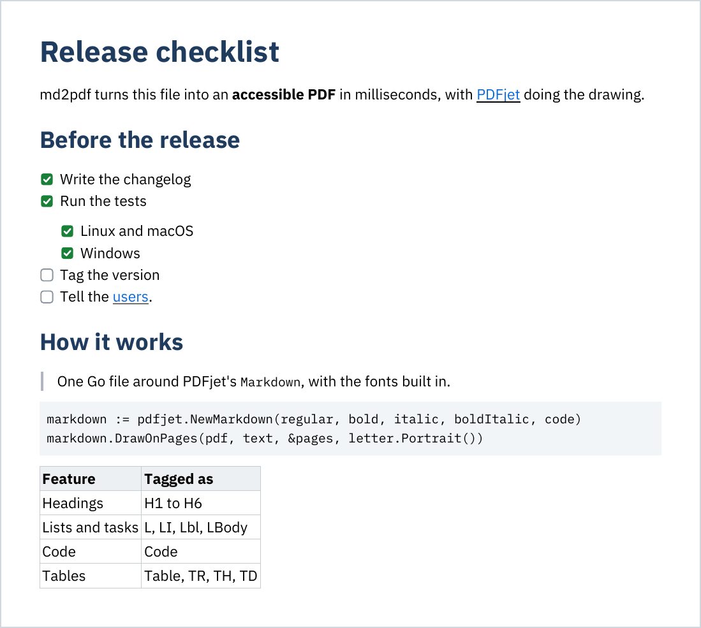

# pdfjet-utils

[](https://github.com/edragoev1/pdfjet-utils/actions/workflows/test.yml)
[](https://github.com/edragoev1/pdfjet-utils/releases/latest)
[](LICENSE)

Small command-line tools built on [PDFjet](https://github.com/edragoev1/pdfjet),
the PDF library for Java, C#, Go and Swift.

## md2pdf

**Markdown to an accessible PDF, in one small program.** md2pdf reads your
`.md` files and writes PDFs that look like Markdown on GitHub: dark blue
headings, blue links, task lists with green checks, code on a gray
background and tables with a header row. Every PDF is PDF/UA, tagged for
screen readers, and checked with [veraPDF](https://verapdf.org) on every
push.

[](docs/sample.pdf)

<sub>[docs/sample.md](docs/sample.md), and the PDF md2pdf made of it,
[docs/sample.pdf](docs/sample.pdf).</sub>

### Install

Download the file for your computer from the
[latest release](https://github.com/edragoev1/pdfjet-utils/releases/latest):
one file of about 4.5 MB, with the fonts inside, that needs nothing else
installed.

| Computer | File |
|---|---|
| Windows | `md2pdf-windows-amd64.exe`, or `-arm64.exe` on ARM |
| Mac, Apple chip (M1 and later) | `md2pdf-darwin-arm64` |
| Mac, Intel | `md2pdf-darwin-amd64` |
| Linux | `md2pdf-linux-amd64`, or `-arm64` on ARM |

Or, with Go 1.26 or later:

```
go install github.com/edragoev1/pdfjet-utils/md2pdf@latest
```

The files are not signed. Windows asks before the first run: "More info",
then "Run anyway". On a Mac or Linux, make the file a program first, and on
a Mac let it run, once:

```
chmod +x md2pdf-darwin-arm64
xattr -d com.apple.quarantine md2pdf-darwin-arm64
```

### Use

```
md2pdf notes.md                      # writes notes.pdf next to notes.md
md2pdf -o out.pdf notes.md           # writes out.pdf
md2pdf -page a4 *.md                 # a PDF for each file, on A4 pages
md2pdf -size 10 -lang fr-CA notes.md # smaller text, in French
md2pdf --version                     # md2pdf v1.0.5, built on PDFjet ...
```

| Option | Default | |
|---|---|---|
| `-o` | the `.md` file's name, with `.pdf` | The PDF to write, for one Markdown file |
| `-page` | `letter` | The page size: `letter` or `a4` |
| `-size` | `11` | The size of the text, in points, from 6 to 24 |
| `-lang` | `en-US` | The language of the text, for screen readers |
| `--version` | | Prints the version of md2pdf and of PDFjet |

### What it draws

- Headings, of `#` and of underlines, with the first `#` heading as the
  PDF's title
- **Bold**, *italic*, `code` and [links](https://github.com/edragoev1/pdfjet)
- Bullet and numbered lists that nest, and task lists: `- [x]` and `- [ ]`
- Quotes, code blocks and thematic breaks
- Tables, with their columns aligned left, center or right
- Images (PNG, JPEG, BMP and SVG) alone in their paragraph, read from the
  folder of the Markdown file and from nowhere else
- A page number at the foot of every page

The text is IBM Plex Sans and the code IBM Plex Mono, embedded as subsets
of the characters used, so a one-page PDF is about 70 KB. A page takes a few
milliseconds.

It is PDFjet's Markdown, not all of Markdown: HTML is drawn as the text it
is, and a line break inside a paragraph is a space. A conversion that fails
writes no file, and the PDF never replaces the Markdown file.

### Accessible by default

The PDFs are PDF/UA-1: the headings are H1 to H6, the lists are lists, the
boxes of the tasks are read as ☐ and ☑, the code is Code, the tables are
tables with header cells, and the images are figures with their alternate
text. The document has its title and its language. CI converts a sample on
every push and fails unless veraPDF passes it.

## Built on PDFjet

md2pdf is about 200 lines of Go around
[PDFjet](https://github.com/edragoev1/pdfjet)'s `Markdown`, which does the
reading, the layout, the tagging and the font subsetting:

```go
markdown := pdfjet.NewMarkdown(regular, bold, italic, boldItalic, code).
	SetHeadingColor(0x1F3A5F).
	SetLinkColor(0x0969DA)
markdown.DrawOnPages(pdf, text, &pages, letter.Portrait())
```

PDFjet has made PDFs since 2001, with the same API in Java, C#, Go and
Swift and no dependencies. The same Markdown is in all four:
see [the repository](https://github.com/edragoev1/pdfjet).

## Building

```
go test ./...
./build.sh        # md2pdf for Linux, Windows and macOS, Intel and ARM, into dist/
```

## License

MIT: see [LICENSE](LICENSE). The IBM Plex fonts built into md2pdf keep their
own license, the SIL Open Font License 1.1: see
[md2pdf/fonts/OFL.txt](md2pdf/fonts/OFL.txt).
